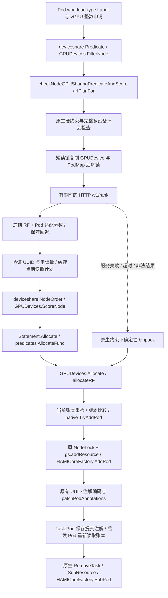

# 第六轮：RandomForest 与 Volcano vGPU 原生设备选择离线集成

## 本轮结果与证据边界

已实现默认关闭的 `rf-job`。Go 实际调用常驻 Python RF 服务，随后进入真实 Volcano `GPUDevices.Allocate` 的 RF 分支，通过原生 `HAMICoreFactory.AddPod` 更新配额，使用原有 annotation 编码与 `patchPodAnnotations` 写入具体 UUID。测试中的最终注解来自 client-go fake 客户端的保存对象，不是直接照抄 Python 推荐当作分配成功。

已完成原生分配/释放、动态重新分类、过期快照拒绝、并发不超分、异常确定性回退。最新完整结果由 [实测汇总](../results/integration-v6/test-results.md) 与 [机器可读核验](../results/integration-v6/verification-summary.json) 给出。167 项 Python 历史及新增测试通过；Go 全部 vGPU 设备测试包含真实 HTTP 联调。Linux scheduler 可编译。Windows 的 deviceshare/predicates 上游测试因 `pkg/util/socket.go:198 unix.Umask` 无法执行；保留失败记录并另行编译 Linux 测试程序，**不把交叉编译当成测试执行通过**。

|层次|本轮证据|
|---|---|
|纯 Python 离线仿真|保留前三策略；历史回归包含各 12 个 Pod、分配释放与重新预测|
|真实 Go→Python 通信|常驻 joblib 服务，实际 HTTP/JSON，请求与响应记录在 rf-http-exchanges.json|
|Volcano Go 设备分配流程|实际 FilterNode / ScoreNode / Allocate，原生 TryAddPod / AddPod / SubPod，fake Kubernetes 客户端读取最终注解|
|完整 scheduler 与真实集群调度|只交叉编译完整 Linux scheduler；没有执行真实 scheduler 的集群调度或提交 Pod|

没有修改线上 scheduler、dqn-job 配置、DQN 服务、驱动或 Device Plugin，没有运行 CUDA 训练/推理。源码复制仅为获得独立开发输入，不将以前的集群快照当成本轮实时采样。

## 源码与历史保留

独立 Git 仓库 `scheduler/volcano-rf/`，分支 `codex/rf-job-v1.13.1`。从部署源码状态导出的原始 Git HEAD 为 `0c6f3bf706ad6790b1e806ef5e65c2ffdb3418ba`，原目录本身含 DQN 定制改动，不能当作纯官方 v1.13.1。

本地导入基线 `20396e2d4742929feb761aca80424d2f487b7a8d` 保存了该状态；RF 实现提交 `fb8e718cbf8d644b4b56a8d7a33de2035cb349ce`，随后 `7d0444b` 补充 Allocate 阶段共享模式、节点一致性和 initContainer 检查。以本地 `git log` 和交付 source manifest 为准。

1175 个普通源/构建文件按原始 SHA256 核对。文档媒体、历史构建输出、缓存、嵌套 `.git` 未复制；两个非 Go 构建输入的 Helm 目录符号链接仅保留在源归档中。保留 `source-baseline-complete/original-working-tree.tar.gz`、完整原修改 diff/status/log 和逐文件来源清单。原 DQN 客户端和三个 protobuf 文件保持原哈希，`hamicore.go`、原始资源算法与 go.mod/go.sum 保留。

先前顶层项目处于未跟踪状态，`git diff` 不会显示这些文件；没有据此声称恢复了缺失的七文件 Git 历史。已有 Python API 继续保留，本轮仅补充单位边界、HTTP 适配和测试；已有模型、规格源和结果目录没有被替换。

## 冻结模型与适用限制

模型版本 `rf-v4-known-states-ee35cfabe30f`，目录 `models/pod-gpu-rf-v1`。启动时一次性校验 manifest 中的哈希并加载 joblib，调度时不训练，也不启动新 Python 进程。历史单元测试会在临时目录拟合小型测试夹具，以检查原训练代码；它们不更新冻结生产模型或新增正式模型。

4090、L40 在原模型的相关验证覆盖内；5090 的相关验证不足，仍可能输出 `pending_verification`。不能因为本轮要集成而放宽验证门槛。Python 保留 RF 原始输出供诊断，对 pending、未知任务组成、不限 cores 的状态使用单独标记的保守评分。最终类别不是具体 Pod 的准入门槛。

静态硬件使用冻结规格库，Go 内嵌其数值副本，Python 校验相同型号的静态字段与固定库一致。未匹配或变体不明确时不猜规格。模型的显存参考容量与原生逻辑容量不完全相同，采用显式、未实测验证的比例表示映射；原生资源过滤和配额扣减完全不使用映射值。详见 [协议及容量域合同](rf-job-protocol-v1.md)。

## 调用链与锁



HTTP 发生在 RF 账本锁释放之后、原生 NodeLock 获取之前。Python 没有集群客户端或真实配额账本。Go 的进程内锁只保护本轮新增快照/提交路径，不替代原生 leader election、session/cache 生命周期和 Device Plugin 锁。

Filter、Score 和 Allocate 读取相同计划规则；缓存 key 包括 Pod、模型、完整可见资源状态。评分后账本改变会触发新快照重新排序；RPC 中途状态变化导致提交时返回 stale，拒绝使用过期 UUID，由原生重试。新配额始终以原生当前账本为准。

原 predicates AllocateFunc 只记录设备 Allocate 错误而不填 `Event.Err`。本轮仅在 RFActive 时补充错误传播，让原生 Statement 能触发回滚；成功后将已提交 UUID 注解同步到 Task.Pod，供原生 RemoveTask/UnAllocate 释放。patch 失败用原生 SubResource 撤销配额。本地客户端更新失败与并发状态变化均有测试。

## 具体代码

|文件|新增/修改及主要函数|
|---|---|
|`pkg/scheduler/api/devices/nvidia/vgpu/rf_job.go`|RFActive、rfPodRequest、rfRequest.MarshalJSON、rfPlanFor、rfCall、rfFits、rfValidate、rfFallback、allocateRF；短锁快照、HTTP、完整 UUID 校验、CAS 提交|
|`.../vgpu/rf_profiles.json`|冻结 NVIDIA 规格数值副本；不是新采集的数据或训练标签|
|`.../vgpu/device_info.go`|FilterNode、ScoreNode、Allocate 的受控入口；AddResource/SubResource 的 RF 同步及任务组成元数据，重复事件不二次记账|
|`.../vgpu/utils.go`|仅新增 rf-job 策略分支；默认关闭时 original 排序；保留原 DQN 分支|
|`pkg/scheduler/plugins/deviceshare/deviceshare.go`|RFEnable / GPUSelectPolicy / Endpoint / ModelVersion / TimeoutMS 配置；启用时默认 ScheduleWeight=1|
|`pkg/scheduler/plugins/predicates/predicates.go`|RF 专用 Allocate 错误传播及 Task.Pod 注解同步|
|`.../vgpu/rf_job_test.go`|mock 异常测试、真实 Python HTTP、实际原生 Allocate/释放与注解核验|
|`gpu_lab/runtime/http_server.py`|常驻 HTTP 服务，启动时一次加载模型，GET health / POST rank|
|`gpu_lab/runtime/volcano.py`|原生逻辑快照转换、静态校验、复用 classify_gpu/rank_gpus、详细分数和回退标记|

资源默认关闭：`RFEnable=false`，还必须指定 `GPUSelectPolicy=rf-job` 和 `VGPUEnable=true` 才启用。本轮并不把旧 dqn-job 参数改为 rf-job。

## 实验 A：相同资源、训练与推理

11 张模拟物理 GPU，三个同型号节点：4090×4、5090×4、L40×3。每张 GPU 都满足 4096 MiB、30 cores、1 vGPU，未用显存不足等过滤人为制造差异。

原始确定性策略在节点评分并列、固定节点顺序的对照中选择 `SIM-sim-4090-GPU-03`。rf-job 两类 Pod 均选择 `SIM-sim-5090-GPU-00`，最终 `volcano.sh/devices-to-allocate` 与推荐 UUID 相同。

**训练与推理本次选择相同，不能宣称已经证明差异化分配优势。** 当前候选都为空闲，5090 的相关验证不足，按保守理论代理和既有硬件/装箱评分排序；5090 的计算与带宽归一项均饱和，因此两类请求得到相同的有效分数约 70.3983。其他候选的分类和各目标分数保存在原始 JSON。没有更改评分权重、模型或标签来制造不同 UUID。

这是 RF 策略参与设备选择、执行合法分配的验证，不是训练吞吐量或推理延迟实验。节点选择对照仅聚合该设备分数及固定并列规则；没有运行真实 scheduler 的所有插件组合。

## 实验 B：原生账本与重新分类

连续全队列分配：A（训练，10000 MiB/65 cores）选择 5090-00；B（推理，6000 MiB/25 cores）使用更新状态选择 5090-01；释放 A 后 5090-00 恢复，C 又可合法选择它。B 的配额保持不变。UUID、配额、类别、双目标分数均由实际 Go–Python 输出生成，见 native-experiments.json。

另用单张 L40 记录连续状态，物理型号和静态硬件保持不变：

|阶段|逻辑剩余 MiB|剩余 cores 配额|已分配 vGPU|理论参考类别|
|---|---:|---:|---:|---|
|初始|46068|100|0|训推一体|
|计算密集份额 4000 MiB/65 cores|42068|35|1|训练优先|
|再分配 34000 MiB/20 cores|8068|15|2|当前不满足参考负载|
|释放计算密集份额|12068|80|1|训推一体|
|全部释放|46068|100|0|训推一体|

类别来自冻结模型及合成参考合同，既不是产品营销定位，也不是实测性能。类别为不可用时，小型具体 Pod 仍可通过自身资源要求；分类不覆盖资源硬过滤。资源变化后按需在下一次请求中重新预测，避免在持账本锁时做网络调用；演示通过新 probe 请求记录每个变化后的实际模型输出。

## 实验 C 与支持范围

已经测试服务连接失败/503、超时、版本不一致、外来 UUID、错误配额/数量/分数、无 Label、非法 Label、显存/算力/实例不足、不健康、后端不兼容、共享模式不一致、评分过程中状态变化、patch 失败回滚、重复 Allocate、重复 informer、20 Pod 并发争用。

服务异常采用确定性 binpack，仍由相同硬约束与 native TryAddPod 校验。无 Label 使用原始确定性顺序与 GPUScore，不调用 DQN 或 RF。非法 Label 显式错误。状态变化拒绝陈旧提交后可重试，不强制旧 UUID。

本轮主要支持 HAMI-core、普通容器、单 vGPU。已执行单容器双 GPU 不同 UUID、CPU 容器在前的注解位置测试。复杂多容器沿用完整贪心可行性检查，可能保守拒绝；没有实现组合优化器。MIG/MPS、GPU initContainer 明确拒绝；百分比只有原生 resourceMemoryPercentageName 已配置才接受，未配置时拒绝而非默默按整卡显存申请。

未运行 Go `-race`（Windows 无 C 编译器），未验证多 scheduler 副本并发或 kubelet/Device Plugin Allocate。当前同步机制只证明本进程原生设备状态下的测试性质；部署前仍需真实独立 scheduler 的小规模只睡眠任务验证。

## 复现

在项目目录终端一：

```powershell
.\.venv\Scripts\python.exe -m gpu_lab.runtime.http_server --port 18081
```

终端二：

```powershell
.\scripts\test_round6.ps1
.\.venv\Scripts\python.exe scripts/summarize_round6.py
```

如使用系统 Go，版本须满足源 go.mod（>=1.24），本次使用隔离的 Go1.26.3、CPU、CGO_ENABLED=0。脚本 Windows 下执行全部 vGPU 包测试与 Python 测试，并为 Linux 编译完整 scheduler/插件测试程序；Linux 主机可直接运行三个 Go 包。正式运行不需要 Python 训练库以外的新推理框架。

原始测试输出、请求响应、UUID/动态状态 CSV、模型与 DQN 哈希均保存在 `results/integration-v6/`。运行重放会更新本轮输出；历史 offline-v1..v5 目录不改。

## 后续部署与回滚（只准备，未执行）

1. 先人工复核本轮代码差异、模型待验证范围和容量映射假设。将 RF scheduler 与 Python 服务打成**新镜像/新路径**，不得挂载覆盖线上 `/home/zbs/volcano-v1.13.1-dqn/_output/bin/vc-scheduler`。
2. 新测试 scheduler 使用 `--scheduler-name=volcano-rf-test`、独立的 leader election 资源名/命名空间、独立 scheduler-conf 和健康端口。先使用只包含明确测试对象的命名空间/权限范围，核对缓存对已有 GPU 配额的重建。独立 schedulerName 本身并不能隔离多个调度器对同一 GPU 的账本：必须另行安排不与在线调度器争抢的测试设备/窗口，或证明两者能按同一原生注解账本一致协调。
3. 建议 Python 同 Pod sidecar，回环 18081，启动先核对 `/health` 的 model_ready 与版本；模型文件只读挂载，不在线训练。按本机依赖固定版本构建，未提供或验证正式容器镜像。
4. `scheduler/config/rf-job-arguments.yaml` 仅为新配置中的 arguments 片段，不是直接替换生产 ConfigMap 的命令。复制原设备资源键及已验证 HAMI-core 配置，不携带 dqn-job 策略给新研究调度器。
5. `k8s/round6/*-sleep.yaml` 仅准备，未提交。`prerequisites.yaml` 显式准备 Namespace/PodGroup，两 Pod 通过 `scheduling.k8s.io/group-name` 关联，避免假定现有 controller 会为新 schedulerName 自动建组；`queue: default` 仍需按实际集群复核。真实验证前另行批准新测试部署、测试时段和设备隔离。两 Pod 都只 sleep，读取最终 `volcano.sh/vgpu-node`、`volcano.sh/devices-to-allocate`、插件日志和原生逻辑指标；不验证计算性能或物理 OOM。保留 nodelock 机制。
6. 回滚只针对新测试 deployment/config/image：停止接收测试 Pod，待测试任务结束并核验原生账本释放，再撤销新测试服务和独立 scheduler。线上原 DQN 镜像、二进制、配置和任务一直保留，不能通过替换旧文件完成“回滚”。禁止随意清除 UUID 注解或手工扣改账本。

逻辑分配成功不代表物理显存已经预留，也不保证后续 CUDA 执行成功。本轮没有测试这些物理行为。
