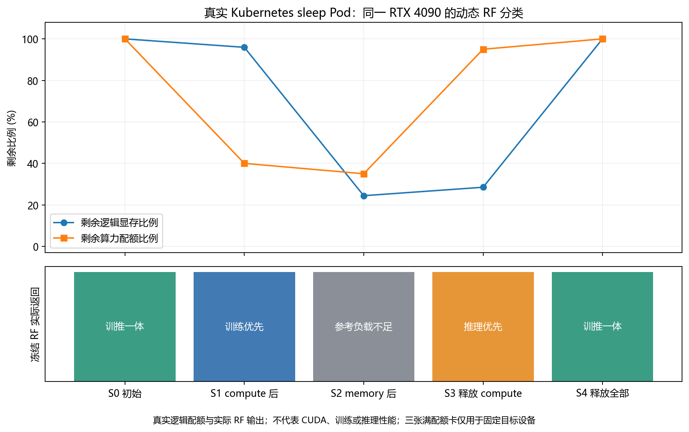

# 第八轮真实 Kubernetes 动态 vGPU 分类验证结果

本次实际在 t3dgq 的四张4090上运行。授权记录 `user-round8-live-20261020`，全部容器仅执行 `/bin/sleep 600`。
未重新训练模型，未改分类门槛、评分权重、Go二进制、DQN服务配置、驱动、Device Plugin或运行时。

## 结果

目标真实 GPU UUID：`GPU-fb6aaeaf-9ca4-3c9a-7b3b-f56714c1f7cd`。
三个 blocker 分别占据另外三张卡的100算力逻辑配额，主过程只有一张硬合法候选卡。
下面类别直接取自实际RF HTTP响应，以原生Allocate的requestID和Pod UID关联，未用离线期望替换输出。

|状态|逻辑剩余MiB|剩余算力|实例数|实际RF类别|状态|触发观测的Pod|
|---|---:|---:|---:|---|---|---|
|S0|24564|100|0|训推一体|provisional|rf-v8-compute|
|S1|23564|40|1|训练优先|provisional|rf-v8-memory|
|S2|6000|35|2|参考负载不足|provisional|rf-v8-observer-0|
|S3|7000|95|1|推理优先|provisional|rf-v8-observer-1|
|S4|24564|100|0|训推一体|provisional|rf-v8-observer-2|

S0由compute提交前的快照观测；S1由memory提交前快照观测；S2～S4由各observer提交前快照观测。
observer自身64MiB/1core另行记账，取证后删除，再进入下一主步骤。
compute申请1000MiB/60cores，memory申请17564MiB/5cores。类别确实完成四类切换，并在资源释放后恢复。
原始硬件特征不变；逻辑注册容量24564MiB，既有模型参考容量映射22888MiB原样保留。
所有预测均provisional，是冻结合成参考合同适配输出，不是实测训练/推理性能标签。

## 八次实际分配

以下每一行的 RF 推荐UUID、原生Allocate永久UUID注解、插件消费UUID均一致。
插件证据是与Pod UID、sleep容器、vgpu-number资源匹配的kubelet checkpoint AllocateResponse.NVIDIA_VISIBLE_DEVICES，
没有将虚拟DeviceIDs或Pod Running当作GPU UUID证据。

|Pod|真实Pod UID|申请MiB/cores|最终UUID（RF=Allocate=Plugin）|
|---|---|---|---|
|rf-v8-blocker-0|2f80a4b1-b58a-489d-860f-a4bd6aee87ac|64/100|GPU-27be0024-0498-4114-e6b9-b2d0db148309|
|rf-v8-blocker-1|b44dd9b5-cac7-4037-b77e-0a665537a009|64/100|GPU-28cf7186-0bdd-be9f-92e5-3c59b4e92c1e|
|rf-v8-blocker-2|161c2cb4-796b-4427-a3d8-13e410029061|64/100|GPU-7b94f673-ce00-719b-2c94-706baa032dae|
|rf-v8-compute|760dfb59-ad6f-406b-979f-e9529c735d16|1000/60|GPU-fb6aaeaf-9ca4-3c9a-7b3b-f56714c1f7cd|
|rf-v8-memory|4ea3089b-6ada-4072-8403-5e1c8a93e09c|17564/5|GPU-fb6aaeaf-9ca4-3c9a-7b3b-f56714c1f7cd|
|rf-v8-observer-0|8a2559f8-108e-46b5-8f20-57b2027b887a|64/1|GPU-fb6aaeaf-9ca4-3c9a-7b3b-f56714c1f7cd|
|rf-v8-observer-1|fdb11bac-d995-4b0c-bdf9-713341a0bc25|64/1|GPU-fb6aaeaf-9ca4-3c9a-7b3b-f56714c1f7cd|
|rf-v8-observer-2|4035b39a-16c4-4bbc-865d-cf08c7cfb288|64/1|GPU-fb6aaeaf-9ca4-3c9a-7b3b-f56714c1f7cd|

独立核对结果：分配合法8/8，三方UUID一致8/8，原生配额增量正确8/8，观察到显存/算力/实例超分配0次，
8个Pod删除与释放均有对应UID原生日志，最终全部GPU逻辑预留归零，NodeLock为空，自己的PodGroup为0。
八次分配均无原生服务异常回退；之前已经验证的故障回退本轮没有重新制造。

原生logicalBefore/After属于实际分配对象，不冒充唯一全局cache事务日志。
API注解重建账本单独标注；SubResource可能出现在多个克隆视图，日志行数不当成释放次数。

## 清理与恢复

主成功窗口暂停原Scheduler：2026-10-20T15:29:08.520172+08:00；恢复完成：2026-10-20T15:31:49.532095+08:00，约161.01秒。
之后独立只读复核记录见 `evidence/attempt2/final-independent-readonly.json`。

- 原Scheduler恢复1/1，Deployment spec与备份一致。
- 原ConfigMap内容相同，resourceVersion仍为 `21788675`。
- 原ResourceQuota完整spec恢复，pods、vgpu-number、vgpu-memory、vgpu-cores的used全部为0。
- RF Deployment恢复0副本，规格与实验前相同；DQN服务保持1/1、spec相同。
- RF模型包全部文件前后SHA一致，joblib为 `ee35cfabe30fffc28ff0be09d3738587d4f9bffbe26386e2a9fae5c5b9e80748`。
- 原Scheduler实际运行的可执行文件SHA前后相同：`9f2e1ae3359ce234fd048bc48aab082add99a686631808908b5ae518bdebf4f4`。
- 不终止宿主机GPU进程，不清checkpoint/NodeLock，不修改二进制、模型权重或GPU组件。

## 保留的首次失败

首次尝试创建了2个blocker，两个均获得一致的RF/原生/插件UUID；随后采集器发生 `KeyError('GPU-27be0024-0498-4114-e6b9-b2d0db148309')`。
原因是错误地要求RF请求包含全部注册卡，而实际 `rfPlanFor` 在HTTP前过滤不适合当前Pod的设备。
该次自动清理了2个Pod与PodGroup，并恢复配额和原Scheduler，原 `experiment_success:false` 原样保留。
修正的是证据采集器：核对RF输入等于原生硬合法子集，并逐项比较该子集当前资源；完整原生前后账本继续核对全部四卡。
没有修改Go策略、模型输入数值、权重或标签。独立attempt2重新做当前检查后获得以上完整八例。
合计本任务创建10个自己的Pod，两个尝试均正常清理恢复；不能把首次未完成轨迹记录成成功实验。

后处理另正确识别API规范化的 `1k` 为1000个自定义资源单位，即1000MiB，不是1000字节。
Pod YAML和Go协议仍使用原先的整数MiB约定，未因此改模型或在线接口。

## 证据、复现与解释边界

- `verified/states.csv`：S0～S4、原始类别、适配、pending状态、RF/启发式/总分与三方UUID。
- `verified/allocations.csv`：8个完整UID、申请、永久注解、节点注解、插件证据。
- `verified/candidate-scores.csv`：实际可行候选的两种任务评分及RF原始结果。
- `verified/native-ledger-transitions.csv`：全部四卡、8次原生Allocate前后计数。
- `verified/release-checks.csv`：8个UID实际释放证据；`verified/summary.json`：验收指标和恢复回执。
- `evidence/attempt1`、`evidence/attempt2`：133个关键源文件文本快照，内容摘要和传输压缩摘要均已校验；
  派生CSV的CRLF被文本传输规范为LF，详见critical-evidence-manifest.json。
- 全量原始档案仍保存在服务器 `/home/zbs/rf-round8-live-20261020-raw.tar.gz` 与
  `/home/zbs/rf-round8-live-20261020-attempt2-raw.tar.gz`，原始字节SHA见final-package.jsonl；不将不完整的大文件下载当成本机完整档案。

本轮证明了真实API、原生逻辑配额、冻结RF动态分类与设备UUID传递的完整链路。
因为另外三张卡被逻辑满核占位，**不能用本轮唯一候选的UUID选择证明RF相对启发式的独立优选收益**。
独立贡献仍以第六轮180组原生Go消融中的37组变化为证据，且那是fake-client实验。
本轮不测CUDA成功、物理显存预分配、训练时间、推理延迟或吞吐量，不宣称真实性能提升。
各状态评分对应不同触发Pod，不能把跨状态总分差当成仅由类别造成的因果效应。

本次授权窗口已完成，执行门已关闭，防止把本次授权用作未来重复实验的长期许可。
本地只读重验：`python -m pytest tests/test_round8_live_receipts.py tests/test_round8_real_evidence.py -q`。
原始大日志仍在服务器，不需要重新切换Scheduler即可取证。
