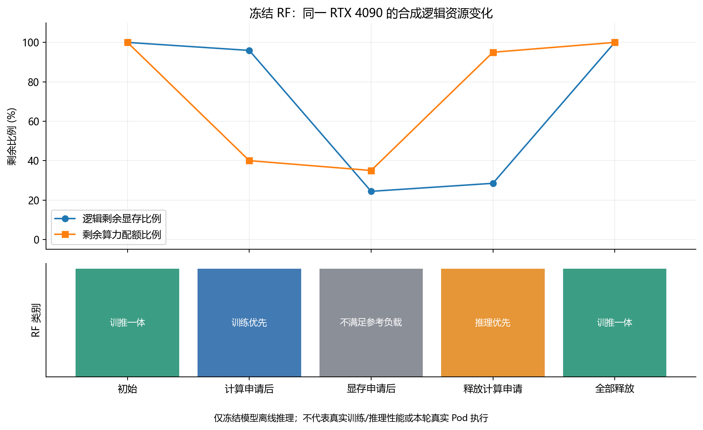
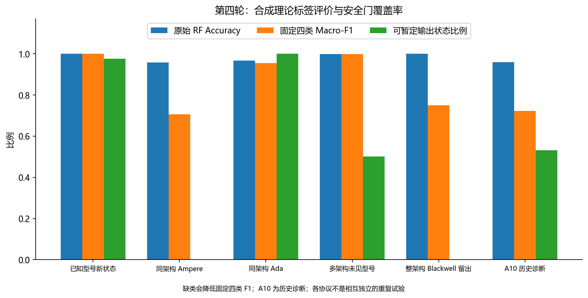
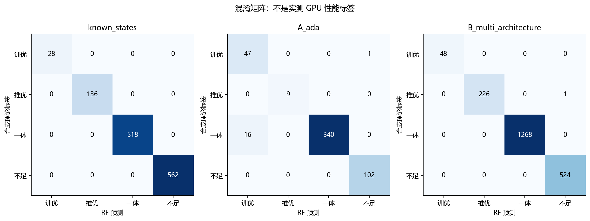
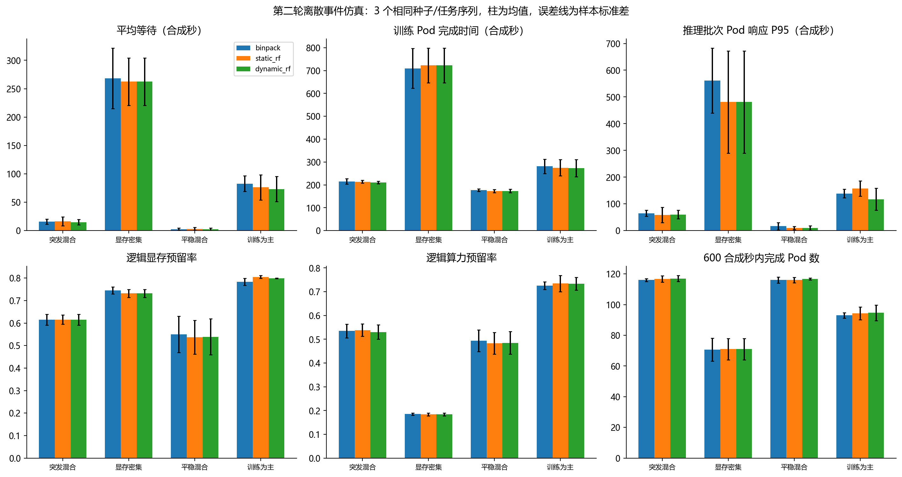
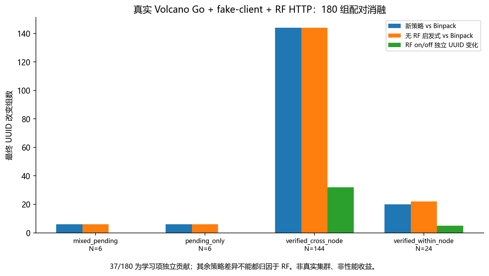
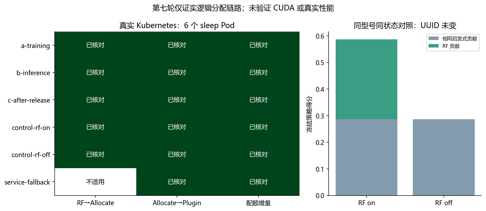
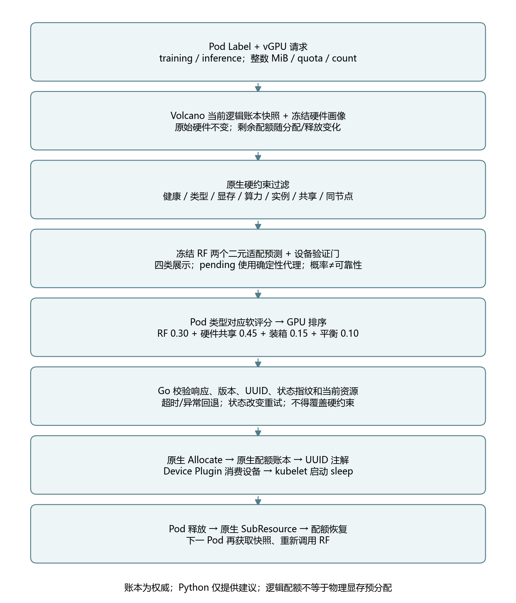

# 基于 RandomForest 的 GPU/vGPU 动态适配分类与 Volcano 逻辑调度：实验汇总

整理日期：2026-10-20。第八轮仅本地 CPU 推理、材料复核和测试；未连接或改动集群。
历史真实集群证据日期为2026-10-19，不能据此声称2026-10-20的在线状态。

## 1. 目前完成了什么

本项目已形成“数值硬件画像与动态逻辑配额 → 两个参考负载的适配预测 → Pod 类型相关评分 →
原生 Volcano UUID 分配与资源释放”的可运行原型。
分类监督来自确定性理论模型，真实 Kubernetes 实验验证的是设备级逻辑分配，不是训练或推理计算性能。

|研究内容|已完成的证据|尚不能据此声称|
|---|---|---|
|异构静态特征和来源保存|22设备/7厂商原始库；第四轮15种NVIDIA配置；来源单位和口径审计|22设备均有统一可比标签、均支持同一运行时|
|静态/动态RF适配分类|训练/验证/测试、型号留出、特征消融、pending门|真实训练/推理性能预测准确率|
|动态资源状态|离线分配释放、已发现4090四类切换路径|真实Pod下四类切换已验证|
|调度方法|Binpack/静态RF/动态RF同轨迹离散事件仿真|实机吞吐量或延迟提升|
|学习项贡献|原生Go+fake-client+HTTP：180组中37组最终UUID改变|37次真实Pod收益、UUID改变一定更好|
|工程集成|真实集群六个sleep Pod，原生→插件UUID6/6一致|已运行CUDA、已验证物理资源隔离|
|异常与释放|HTTP失败真实回退1例；原生资源增量6/6；自己的6个Pod删除与释放证据|已覆盖所有并发竞争和设备故障|

统一机器可读结果见 [unified-experiments.csv](../results/round8-20261020/unified-experiments.csv)。
所有输入材料的相对路径、SHA256和证据类型见 [evidence-source-index.csv](../results/round8-20261020/evidence-source-index.csv)。
本轮不覆盖历史数据；新增文件在 `results/round8-20261020`。

## 2. 研究对象、特征和参考合同

### 2.1 静态参数

保存显存容量MiB、带宽GB/s、FP32 TFLOPS、FP16 dense TFLOPS、BF16 dense TFLOPS、INT8 dense TOPS、最大板卡功耗W。
同时记录厂商、型号、架构、形态、后端、精度、来源URL、原始单位和规格口径。
稀疏/非稀疏、Tensor/Core常规向量、PCIe/SXM、多芯片整板与单芯片不可混合。
第三轮来源审计为22条记录、7厂商、16条进入当时可比GPU范围；NPU等保留接口和缺失值，不强行套用NVIDIA执行模型。

当前冻结NVIDIA模型的共同有效硬件数值主要是容量、带宽、常规dense FP32与功耗。
不一致的FP16/BF16/INT8口径仍在数据库保存，但模型输入中掩码，不凭型号补值。
缺失值处理只用训练集拟合；关键数值不足、覆盖不足时输出待验证，不能把插补后的数值当成官方实测值。
厂商、型号和架构名称不是RF数值预测特征；架构元数据用于选择相关验证证据，不当监督标签。

原始来源：[第三轮硬件库](../results/offline-v3-release/hardware-catalog.csv)、
[逐参数来源](../results/offline-v3-release/parameter-sources.csv)、
[冻结来源记录](../models/pod-gpu-rf-v1/source-records.json)。

### 2.2 动态参数

五项动态参数是剩余逻辑显存、剩余算力配额、已分配vGPU实例数、训练vGPU数和推理vGPU数；
增加剩余显存比例和剩余算力比例。另行保存不同Pod计数，不与vGPU实例数混淆。
物理硬件原始能力不变，变化的是参考负载对当前剩余配额的适配性。
算力配额在本实验中为HAMI-core的0–100逻辑账本，不是实测利用率，也不等价于其他厂商资源语义。
可增加 `FP32 × quota/100` 与带宽缩放代理；它们是理论假设，不表示真实性能必然线性变化。

当前默认冻结模型使用15个特征列，即七项静态、五项动态、两项比例及有效FP32代理。
顺序、掩码和参数以 [manifest](../models/pod-gpu-rf-v1/manifest.json) 与
[metadata](../models/pod-gpu-rf-v1/model-metadata.json) 为准。

### 2.3 合成参考负载与标签含义

冻结合同 `cross-gpu-fp32-synthetic-v3` 使用普通dense IEEE FP32，排除TF32/Tensor矩阵峰值混用。

|参考负载|显存需求（模型参考MiB）|最低算力配额|工作量TFLOP|流量GB|理论时间上限|等价最低吞吐|
|---|---:|---:|---:|---:|---:|---:|
|training|8192|20|2.0|8.0|0.2s|5/s|
|inference|4096|10|0.06|2.5|0.01s|100/s|

采用声明的效率0.35（算力）和0.55（带宽），理论时间为：

`max(work_TFLOP / (FP32_TFLOPS × 0.35 × q), traffic_GB / (bandwidth_GBps × 0.55 × q))`，其中 `q=quota/100`。

标签同时取决于资源门槛和理论时间门槛，并非只按任意显存比例划类。
这些参数不是某个真实训练模型或推理服务的测量结果。模型高准确率表示拟合这份合成合同，不能包装成真实性能准确率。
两个二元适配结果组合为训练优先、推理优先、训推一体、参考不足；信息不足另外输出待验证。
“训推一体”表示两种参考负载分别可适配，不证明它们同时共运行仍满足性能门槛。
Pod显式Label选择其类型，系统不检查镜像中的程序来猜测任务类型。

## 3. 新增：4090动态四类切换离线实证

固定 `rf-v4-known-states-ee35cfabe30f`，冻结硬件画像及合同，没有重新训练、改阈值或权重。
初始逻辑注册容量采用上一轮真实记录的24564 MiB、100 cores、最多10实例；本轮UUID/Pod UID均明确为 `SIM-`。

|步骤|操作（MiB/cores）|逻辑剩余MiB|剩余cores|实例数|训练适配|推理适配|实际冻结RF输出|
|---|---|---:|---:|---:|---|---|---|
|S0|初始|24564|100|0|是|是|训推一体|
|S1|分配 compute：1000/60，training|23564|40|1|是|否|训练优先|
|S2|分配 memory：17564/5，inference|6000|35|2|否|否|不满足参考负载|
|S3|释放 compute：返还1000/60|7000|95|1|否|是|推理优先|
|S4|释放 memory：返还17564/5|24564|100|0|是|是|训推一体|

五步均为 `provisional`，原始RF类别与最终展示类别一致；没有通过pending回退伪造类别切换。
静态硬件不变，最后恢复全部动态资源与任务计数。完整原始响应、概率、原因、软评分、请求与释放回执见：
[JSON](../results/round8-20261020/dynamic-path.json)、[CSV](../results/round8-20261020/dynamic-path.csv)。

冻结接口原有的显存特征映射必须保留说明：历史目录参考容量为22888 MiB，真实账本为24564 MiB。
模型参考剩余显存使用 `floor(logical_free × 22888 /24564)`，五步分别为22888、21956、5590、6522、22888 MiB。
原生准入和扣账始终使用原始逻辑MiB，**没有把24564改为22888来做原生分配**。
映射为历史兼容措施，未经物理性能验证；模型参考显存门槛不能不经映射直接当成原生账本门槛。

S1在剩余40%算力下，训练理论时间约0.173s≤0.2s，而推理带宽时间约0.0113s>0.01s，因此有训练优先状态的理论依据。
S3显存参考值6522小于训练要求8192而足够推理，95%算力又满足推理时间约0.00475s≤0.01s，因此为推理优先。
这些是解释参考合同的计算，不是新建标签来覆盖RF。S2参考不足仍可接收64 MiB/1 core小Pod，说明类别不是所有Pod的准入开关。

网格扫描另固定为一个训练vGPU，遍历27种显存值、20种剩余算力配额（540个合成状态）；
剩余100 cores且已有一个实例意味着该实例请求0 cores（HAMI不限流），27个此类状态按既有机制返回待验证，不能伪装成有确定配额的可用状态。
它用于展示冻结函数的形状，不是独立测试集，不新增模型准确率，不将预测回灌成监督标签。
见 [phase-grid.csv](../results/round8-20261020/phase-grid.csv)。



图1说明：当前剩余配额可改变参考训练/推理适配类别；全部释放后类别和资源恢复。
本图全部是冻结RF离线输出，尚未在真实Pod上验证这条类别切换轨迹。

## 4. 训练、验证、测试划分及分类结果

第一轮9123个合成状态，训练5399/验证1799/测试1925，按episode防止相同实验轨迹泄漏。
第三轮合成4867个状态：已知型号新状态为2907/988/972；未知型号为3061/885/921，后者按型号分组。
第四轮7710个合成状态，默认已知型号协议为3667/1240/1244；未知协议按型号分组，严格外推另列。
默认协议不使用全部7710行，三款全新独立测试型号不进入默认训练/验证。

所有保留划分记录的sample、episode、feature hash交叉重叠检查为0；未知协议另检查型号不重叠。
已知型号协议中型号有重叠是实验定义所需，不是对未知型号泛化的证明。
训练拟合插补与RF，验证选择少量特征/叶节点参数，测试仅作最终评价。
本轮只读取保存的结果，未再次调参。

|历史协议|测试N|Accuracy|固定四类Macro-F1|实际出现类别F1|暂定输出状态覆盖|
|---|---:|---:|---:|---:|---:|
|第一轮已知状态|1925|99.8961%|0.9965|—|历史门定义不同|
|第三轮已知状态|972|98.8683%|0.9769|—|100%|
|第三轮未见型号|921|76.5472%|0.5778|—|0%（旧全局门）|
|第四轮已知状态|1244|100.0000%|1.0000|1.0000|97.59%|
|同架构Ampere留出|522|95.7854%|0.7058|0.9411|0%|
|同架构Ada留出|515|96.6990%|0.9547|0.9547|100%|
|多架构未见型号B|2067|99.9516%|0.9992|0.9992|50.17%|
|整Blackwell架构留出|1044|100.0000%|0.7500|1.0000|0%|
|A10历史诊断|514|95.9144%|0.7225|0.9633|53.11%|

这里的Accuracy全部针对合成理论标签；历史行不能当作同一固定测试集上的逐轮提升曲线。
Ampere、Blackwell和A10测试缺训练优先真类，固定四类F1将缺类计0；同时提供观察类别F1，不能隐藏缺类。
原始准确率与可安全暂定的覆盖率需一起看：例如Blackwell原始100%也不能宣布所有未知卡可可靠使用。
Ada可暂定515个状态中有17个误判；B可暂定1037个状态中0个错误，剩余1030个未被验证门接受。
这只是域内合成验证证据，不是校准后的实测置信度或错误率保证。

全新独立型号清单为RTX A6000、RTX6000 Ada、RTX5080，保存在所有协议训练/验证之外。
A10之前已经看过，故仅诊断；H200与5090等历史观察型号不能重新包装成盲测。
各协议测试对象存在交集，不把多个协议当成独立重复试验来扩大样本量。
逐型号、逐类Precision/Recall/F1、各类数量与混淆矩阵均已重新汇总：
[逐型号](../results/round8-20261020/classification-per-model.csv)、
[逐类](../results/round8-20261020/classification-per-class.csv)、
[全部划分](../results/round8-20261020/classification-all-splits.csv)、
[划分审计](../results/round8-20261020/split-audit.csv)。





## 5. 特征消融的解释范围

第四轮B协议：baseline14测试Accuracy94.44%、Macro-F1 0.8568；只相对显存组合89.16%、0.7534；
有效FP32组合97.53%、0.9338；有效带宽96.42%、0.8911；有效FP32+带宽99.9516%、0.9992。
选择 effective_both 的依据是验证集；增加balance列未进一步改善，本轮没有重新选择默认模型。
完整8种特征组合和验证结果见 [feature-ablations.csv](../results/round8-20261020/feature-ablations.csv)。

物理含义明确的派生特征帮助RF表达合成规则的乘法关系；规则也使用类似代理，因此这种改善可解释为更容易拟合理论函数。
它不能证明真实共享性能线性随配额变化，也不能作为实测跨架构能力的替代。
默认部署包仍选known_states以覆盖4090/5090/L40，未为采用更高B测试准确率而换包。

## 6. Binpack、静态RF、动态RF仿真

第二轮主实验固定11卡配置（4090×4、5090×4、L40×3），每场景3种子，每条轨迹120Pod、600合成秒观察期，
三种策略使用相同轨迹哈希、性能模型和硬约束；观察期后继续排空。
本轮直接从保存的逐次运行CSV重新计算均值、样本标准差，与历史summary逐值核对通过。
执行时间模型独立于分类器，用计算能力、带宽、Amdahl/共享干扰及固定种子噪声生成时长，不直接用预测类别评判收益。
两者仍共享理论硬件假设，未实测校准，存在模型设定偏差。

|场景|策略|平均等待（合成秒）|训练完成（合成秒）|推理批Pod响应P95（合成秒）|
|---|---|---:|---:|---:|
|突发混合|Binpack / 静态 / 动态|15.884 /16.394 /14.906|214.881 /213.919 /210.272|64.928 /58.889 /60.036|
|显存密集|Binpack / 静态 / 动态|268.408 /262.614 /262.609|709.483 /722.722 /722.705|561.215 /481.043 /481.043|
|平稳混合|Binpack / 静态 / 动态|2.510 /3.078 /2.528|177.356 /173.204 /173.293|16.438 /10.232 /9.947|
|训练为主|Binpack / 静态 / 动态|82.811 /76.106 /73.212|281.103 /275.067 /272.766|138.698 /157.753 /117.407|

动态相对Binpack在训练为主场景平均等待下降11.59%、训练完成下降2.97%；显存密集场景训练完成反而上升1.86%；
平稳场景平均等待上升0.71%。推理批Pod P95下降7.53%–39.49%，但不是在线推理单请求或token延迟。
静态策略在突发推理P95优于动态，不能声称动态全面胜出。
只有三个随机种子，图误差线为样本标准差，不作统计显著性宣称。



逻辑利用率定义为观察期内已预留配额积分/总逻辑容量/观察时长，不是nvidia-smi物理利用率。
观察期完成数量、排空完成数量、显存/算力预留率及标准差见 [simulation-main.csv](../results/round8-20261020/simulation-main.csv)。
每个轨迹排空后120Pod均完成、未拒绝；不能据此宣称600秒内也全部完成。
第四、五轮60Pod回归仅证明接口兼容，不合并为新的多种子性能实验。
第二轮旧RF消融会归一化剩余权重；第六轮on/off仅删除学习项、不归一化，二者不能合并为同一因果实验。

## 7. RandomForest对最终UUID的独立贡献

第六轮Linux原生Go测试执行真实 FilterNode/ScoreNode/Allocate/SubResource 与真实RF HTTP，API Server为fake-client，UUID为合成标识。
180个相同Pod、相同状态、相同硬约束、相同启发式的配对案例中，仅切换学习项，最终UUID改变37组（20.56%）。
其中同节点不同物理GPU改变5组，跨节点案例32组；这同时涉及节点评分和原生设备UUID分配，不只是Python推荐。

|案例族|N|新策略vs Binpack UUID变化|无RF启发式vs Binpack|RF on/off独立变化|
|---|---:|---:|---:|---:|
|mixed_pending|6|6|6|0|
|pending_only|6|6|6|0|
|verified_cross_node|144|144|144|32|
|verified_within_node|24|20|22|5|
|总计|180|176|178|37|

不同对照列互相重叠，不能相加成独立收益数量。所有案例候选均满足原生硬约束，排除了“卡不够资源被过滤”对本消融的解释。
pending设备学习项贡献为0，保守代理仍可改变相对Binpack选择；这部分不是学习贡献。
33个变更案例的两个所选设备均满足参考硬门并处于provisional，另外4例不能计入更强限定的见证集合。
案例是确定性构造的诊断快照，37/180不是生产任务中的发生概率，UUID改变不等于任务性能变好。



原始逐设备类别、适配、pending、学习/启发式项与最终分配已保留在
`results/rf-ablation-20261019/linux-final/candidate-scores.csv` 和 `decisions.csv`，本轮重新核对汇总。
当设备相关预测不同且学习项足以改变总排序时，RF能够影响UUID；候选预测项相同、差距不足、唯一硬合法候选、
pending回退、服务失败或rf关闭时，不能归因于RF学习项改变决策。

## 8. 第七轮真实Kubernetes六Pod证据

实际短时窗口为2026-10-19 19:39:12–19:42:39（北京时间，约207.63秒）。
在已协调提交窗口内临时停原Scheduler，独立RF scheduler运行六个自己的sleep Pod，结束后原DQN scheduler恢复。
未运行CUDA、训练、推理，也未清理其他用户GPU进程。

以下缩写：U1=`GPU-27be0024-0498-4114-e6b9-b2d0db148309`，U2=`GPU-28cf7186-0bdd-be9f-92e5-3c59b4e92c1e`。

|例|任务类型|最终UUID|RF建议核对|插件消费核对|申请MiB/cores/实例|
|---|---|---|---|---|---|
|A training|training|U1|一致|一致|4096/20/1|
|B inference|inference|U2|一致|一致|4096/20/1|
|删除A后C|training|U1|一致|一致|4096/20/1|
|control on|inference|U1|一致|一致|4096/20/1|
|control off|inference|U1|诊断建议一致，学习项关闭|一致|4096/20/1|
|service failure|inference|U1|无真实RF建议，不纳入三方分母|一致|4096/20/1|

六个Pod的完整UID/UUID：[real-six-pods.csv](../results/round8-20261020/real-six-pods.csv)。
插件实际UUID来自kubelet设备checkpoint中匹配Pod UID+容器sleep+资源vgpu-number的AllocateResponse环境变量，
不是只看Pod Running或虚拟DeviceIDs。临时注解清除后使用永久注解和原生日志交叉验证。

|逻辑验收指标|真实结果|
|---|---|
|合法分配并启动|6/6|
|原生Allocate→插件消费UUID|6/6|
|RF→原生→插件UUID（成功返回建议）|5/5，含学习项开启4、关闭1；故障例排除|
|原生配额增量正确|6/6；各4096 MiB/20 cores/1实例|
|观察到的超分配|0|
|自己的Pod删除和释放|6个UID，有SubResource及后续活快照/最终指标支持|
|RF拒绝连接回退|1/1合法分配|
|类别变化|20个候选记录全部balanced，未观察到切换|
|RF on/off UUID变化|0（一个配对控制）|
|最大观察逻辑预留|显存8192/98256=8.3374%；算力40/400=10%；实例2|
|参考请求碎片率|0，定义相对于4096MiB/20cores/1实例，不是物理显存碎片|

B确实读到了A占用后的20468 MiB/80 cores/1实例；删除A后C在相同RF进程中读到U1恢复24564/100/0，
U2仍被B占用20468/80/1。分类未变化，但账本更新和后续预测链路成立。
真实on/off控制四张4090同状态、同balanced预测；每张学习项都是0.3，启发式0.2867419838626874，
开启总分0.5867419838626874、关闭0.2867419838626874，排序和UUID均未变。
这不能作为真实环境中RF独立选择收益的证据。



原生日志logicalBefore/After是分配对象快照，SubResource含克隆视图重复，不能把日志行数当全局事务数。
Pod注解重建账本与直接观测快照分别保存；最终指标归零只是支持证据，不冒充全局私有cache导出。
原执行器末步错误地把fallback原因字符串按布尔值检查，原始 `experiment_success:false` 保留；
后来按保存的真实UID、Allocate及插件checkpoint独立核对了六例，并修正证据解析器。没有回写原始失败为成功。
恢复后记录确认原scheduler 1/1、原二进制与配置一致、RF 0副本、自己的Pod和PodGroup为0、锁正常释放；
这都是10月19日记录，本轮未重新查询。

## 9. 真实动态类别切换实验的待批准方案

本地实际vGPU源码没有通用Pod UUID输入白名单。`volcano.sh/gpu-index`不能从gpushare路径移用，分配注解不能预写成请求。
为验证**同一张**4090，准备三张卡分别由64MiB/100cores的sleep占位，其余唯一UUID承接S0–S4主过程。
原生100cores请求要求空设备，因而三个占位Pod必须落在不同UUID；所有主请求cores>0，无法落到已满核设备。
四卡Python离线账本测试、分配/释放和观察器恢复均已实际通过；并非新执行的Go或集群测试。

主Pod分配后RF不会自动周期性调用；后续小observer（64MiB/1core）提交才触发当前账本上的真实RF评分。
因此在S2、S3、S4分别使用一个observer，取证即删，明确记录其自身配额影响。未实现的HTTP `/v1/classify` 路由不能假装存在。
三方UUID依然要实际核对；不能用离线pool的commit回执代替Volcano Allocate。

峰值6Pod、18820MiB、366cores，超过上轮预算4Pod/16384MiB/80cores，需要备份、临时扩大自己测试Quota并恢复。
完整 [待批准YAML和执行/停止/回滚方案](../k8s/round8-pending-approval/README.md) 已生成，执行门为false。
这会临时占用三张卡100%的**逻辑配额**，不执行对应GPU计算；仍需节点使用和提交窗口新授权，不能视为零影响。
原DQN只在新授权窗口中临时停副本，二进制与配置不改；结束清理自己的Pod、RF停机、Quota恢复、原Scheduler恢复。

不要求清物理显存，宿主机进程不当作逻辑配额占用；但镜像缓存、Runtime、Device Plugin、NodeLock、
普通GPU/vGPU双入口与其他提交者竞争仍需窗口前只读核验。若唯一候选或三方UUID证据不成立，停止，不绕过原生约束。
现在**不能开始真实Pod测试**：缺本轮明确写操作授权和新的协调窗口，且本轮有意未重新检查在线前置状态。

可选异构扩展暂不作为收尾必做项：已有原生异构消融支持UUID独立影响，真实四类路径验证优先。
若未来扩展5090/L40，需单独新节点/镜像授权；各候选同请求均硬合法，对比native、RF-off、RF-on三路，
pending代理单列；不能把硬过滤或保守排序当学习增益，也不保证training/inference必选不同设备。

## 10. 源码、版本与核心流程

Volcano独立分支 `codex/rf-round7-canary`，提交 `1a5caec7cb44b7a939f6413057596af3cd1ec19a`；本轮工作树无修改。
对照已导入定制部署基线 `20396e2d4742929feb761aca80424d2f487b7a8d`，共有6个运行时Go文件新增/修改与5个测试文件：

- `vgpu/rf_job.go`：HTTP协议、预测计划、校验、回退与原生提交。
- `vgpu/rf_canary.go`：显式实验范围与配置约束。
- `vgpu/device_info.go`：Filter/Score/Allocate/SubResource接入和账本输出。
- `vgpu/utils.go`：资源与原生设备选择衔接。
- `plugins/deviceshare/deviceshare.go`：rf-job显式开关与配置。
- `plugins/predicates/predicates.go`：原生Allocate错误传播与衔接。

详细新增/修改状态、SHA和测试文件见 [volcano-modified-files.csv](../results/round8-20261020/volcano-modified-files.csv)。
`hamicore.go`维持原生实现；DQN文件未删除，本研究不调用其学习策略。
精确函数位置见 [source-call-chain.csv](../results/round8-20261020/source-call-chain.csv)：
`resourcereqs`→`FilterNode/ScoreNode`→`rfPlanFor`→`rfFits/canFitForOrder`→RF HTTP→`rfValidate`→
`allocateRF`重新校验→`commitNativePlan`→原生AddResource/HAMICore→UUID注解；完成后`SubResource/SubPod`释放。

RF只在进程启动时加载joblib，不每次重训；Go按超时、版本、UUID、状态快照等校验；模型建议不持有另一套Kubernetes账本。
动态类别是软排序信息，准入由原生显存、算力、实例、健康、共享和多设备约束决定。

模型版本 `rf-v4-known-states-ee35cfabe30f`；joblib SHA256：
`ee35cfabe30fffc28ff0be09d3738587d4f9bffbe26386e2a9fae5c5b9e80748`。
RF参数120树、min_samples_leaf=2、max_features=0.85、seed20261017；CPU；来源数据版本与完整特征顺序保存在manifest。
原第七轮RF scheduler二进制SHA为 `501e9ece8f838fc2abcc82f5ea731e399178705f7a0bda0d6c02c8eac6b0d7e9`；
生产DQN二进制SHA为 `9f2e1ae3359ce234fd048bc48aab082add99a686631808908b5ae518bdebf4f4`，两者不可混淆。
本轮模型包全部文件前后哈希一致，记录 [frozen-artifact-audit.json](../results/round8-20261020/frozen-artifact-audit.json)。



## 11. 论文写作可直接采用的结论与限制

实验表明，在声明的合成参考负载合同内，将静态数值能力与当前vGPU逻辑状态联合输入随机森林，
能够在同一GPU上输出随资源变化的适配类别。硬件身份不变而逻辑配额改变，分类可在四种状态间切换并随释放恢复。
引入计算与带宽代理有助于拟合跨型号的理论函数，但未知设备的可用输出还受相关验证覆盖限制。

在构造的原生Go配对案例中，学习项独立改变了37/180组最终设备UUID，说明它已进入实际设备选择流程。
在单4090节点六个真实sleep Pod实验中，系统完成了合法逻辑分配、UUID传递和释放，
然而相同硬件/状态的RF项相同，真实on/off控制没有改变UUID。因此，工程连通性已获真实验证，
真实异构优选收益和真实动态四类切换仍不能宣称完成。

离散事件模型显示动态策略在部分合成场景改善等待与完成时间，同时存在平稳等待和显存密集训练完成时间变差的反例。
这些结果应作为算法行为分析，不能外推为真实GPU训练/推理加速。

主要局限：①无足量独立真实性能标签；②配额线性缩放、固定效率和显存参考映射均为假设；
③设备规格/形态缺失与算力口径限制；④厂商/NPU后端与配额语义不能直接统一；
⑤未知架构的门控会拒绝相当部分状态；⑥RF票数不是可靠概率；⑦合成案例选择和少量种子限制统计推广；
⑧fake-client不覆盖真实所有并发/故障；⑨六真实Pod数量少且仅一同型号节点；
⑩sleep不测试CUDA成功、OOM、吞吐或干扰；逻辑分配成功不保证CUDA运行成功。

## 12. 复现与材料目录

在项目根目录，仅本地CPU执行：

```powershell
.venv/Scripts/python.exe -m gpu_lab.round8
.venv/Scripts/python.exe -m gpu_lab.thesis
.venv/Scripts/python.exe -m pytest tests/test_round8.py -q
```

`round8`直接加载冻结包，重现路径、540状态网格、四卡占位可行性和待批准YAML；`thesis`只重算历史统计和画图，不重跑训练或真实实验。
完整回归命令与本轮实际测试结果保存在结果目录的 `test-results.json`；历史Linux原生Go测试证据保持原文件日期，
本轮不把Windows Python测试或交叉编译写成新Linux Go测试通过。

图表均提供190dpi PNG和可缩放SVG；SVG中文字转为路径，便于论文排版不依赖目标电脑字体。
共有动态路径、状态网格、分类协议、混淆矩阵、六指标仿真、原生消融、真实分配、特征消融、核心流程9组图。
流程图另有Mermaid源；各CSV为UTF-8 BOM，带来源与数据类型。图题中的合成/原生fake-client/真实sleep限定应随图保留。
