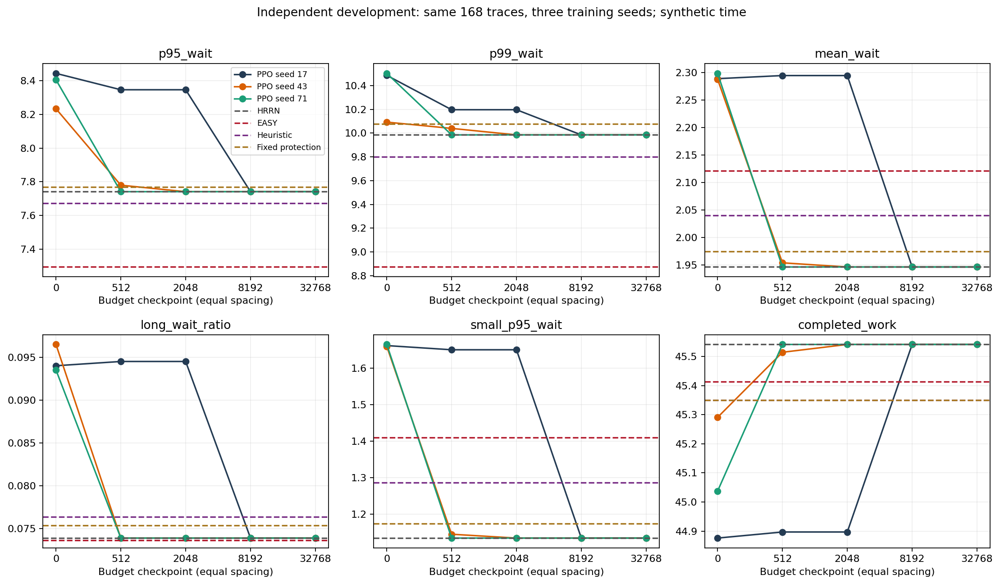
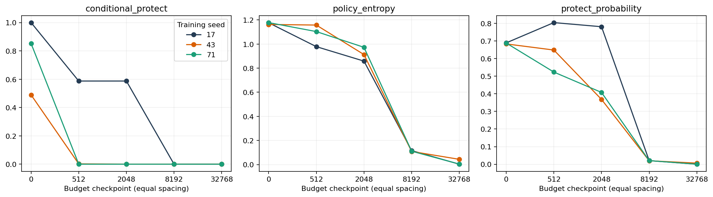
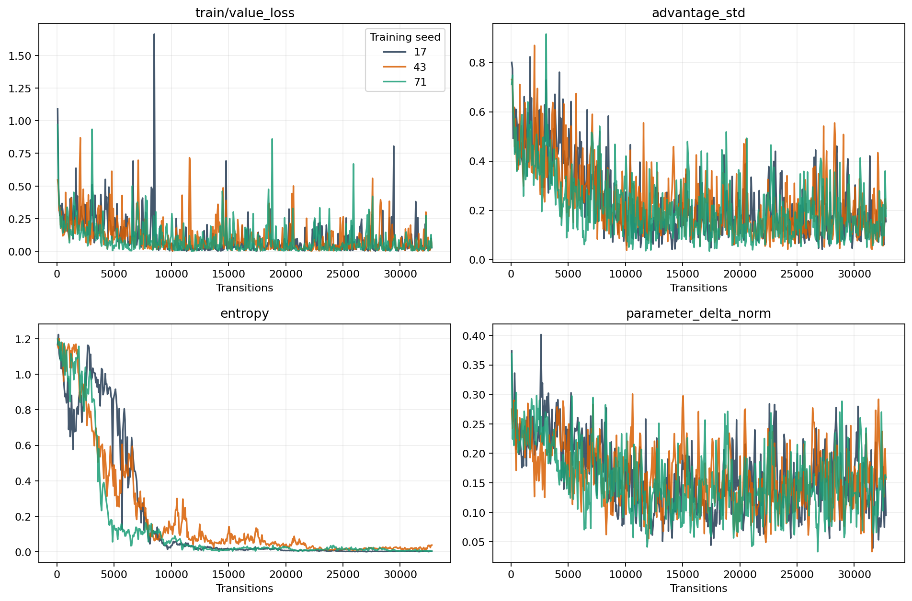
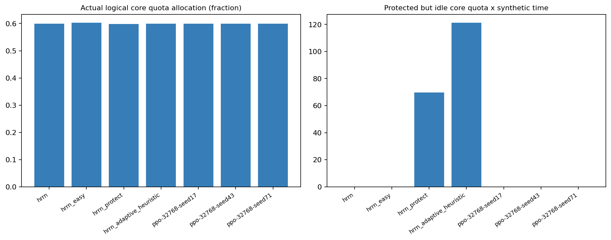

# HRRN-PPO 学习有效性与训练预算实验

**本轮判断：停止当前强化学习路线，转而完善已验证的HRRN队列机制。**

这是一项基于新训练/开发数据的阶段性工程与研究取舍，不是“PPO永远学不会”或“空间保护不可能有效”的证明。
最高实际完成预算为每种子 **32768 transitions**，3个训练种子；较512步增加 64 倍。没有通过预先声明的晋级条件。
8192步相对2048步的均值仍有改善，因此按冻结规则执行了32768步；结果仍未达到晋级门槛，没有生成或运行新的最终测试。
旧第三阶段正式测试仅用于行为诊断，未用于本轮预算或模型选择；它没有被重新命名为新盲测。

## 实现与协议

新增独立 `gpu_lab/queue_rl_budget/`，复用冻结 HRRN、EASY、完整Job提交、三维资源账本和RF候选后端。
joint 202维观察、0/A/B/C动作、[64,64]网络、学习率3e-4、64步rollout、32 batch、6 epochs、gamma=lambda=1、熵系数0.01、idle奖励权重1均保持原定义。
连续分段训练在512、2048、8192处保存**完成该预算更新之后**的模型；128步逐位一致性测试验证分段与遥测不改变更新。
奖励和归一化沿用原模型；并未为了更好的开发结果重新调奖励、阈值或RF。
336条新训练轨迹，168条新开发轨迹（12个工作负载种子块×14场景/误差组合），与旧train/dev/test种子均不重叠；生成分布相同。
网络训练种子为17、43、71。未训练PPO是各训练种子自身的初始模型，不是另选随机初值。
冻结的输入SHA和评价门槛见 `input-freeze.json`、`protocol.json`，时间早于本轮训练/开发评价。

主要指标为全Job等待P95；晋级需至少2/3训练种子同时：比HRRN改善≥3%，比最好的EASY/固定保护/启发式改善≥1%；小Job P95增长不超过max(0.05,5%)，长等待比例增加≤0.5个百分点，窗口完成工作量损失≤1%。此外三种子均值需比512步改善≥1%、比未训练改善≥3%。
这些是预先声明的研究投入边界，不是看完结果后选择的胜负标准。

## 新开发集完整比较

等待单位为合成时间，长等待列为比例，工作量为合成 core-quota×GPU数×时长，不是FLOPs。所有等待指标在轨迹完整排空后统计；完成工作量按原固定窗口。

| 方法 | 平均等待 | P95 | P99 | 长等待比例 | 小Job P95 | 大Job P95 | 窗口完成工作量 |
| --- | --- | --- | --- | --- | --- | --- | --- |
| hrrn | 1.9464 | 7.7414 | 9.9854 | 0.0739 | 1.1351 | 9.8002 | 45.5411 |
| hrrn_easy | 2.1212 | 7.2943 | 8.8737 | 0.0737 | 1.4104 | 8.2880 | 45.4134 |
| hrrn_protect | 1.9745 | 7.7695 | 10.0776 | 0.0754 | 1.1746 | 9.8656 | 45.3500 |
| hrrn_adaptive_heuristic | 2.0405 | 7.6728 | 9.8022 | 0.0764 | 1.2865 | 9.5193 | 45.3496 |
| PPO 0（3种子均值） | 2.2918 | 8.3612 | 10.3608 | 0.0947 | 1.6616 | 9.5632 | 45.0681 |
| PPO 512（3种子均值） | 2.0650 | 7.9560 | 10.0742 | 0.0808 | 1.3102 | 9.7440 | 45.3174 |
| PPO 2048（3种子均值） | 2.0625 | 7.9431 | 10.0560 | 0.0808 | 1.3067 | 9.7328 | 45.3264 |
| PPO 8192（3种子均值） | 1.9464 | 7.7414 | 9.9854 | 0.0739 | 1.1351 | 9.8002 | 45.5411 |
| PPO 32768（3种子均值） | 1.9464 | 7.7414 | 9.9854 | 0.0739 | 1.1351 | 9.8002 | 45.5411 |

PPO不能仅凭比未训练随机偏好更好就宣称有调度收益，必须同时看相同轨迹上的HRRN、EASY和简单自适应规则。
各条件（含低负载、高负载、估计低估/高估/随机误差、多GPU）完整对照在 `analysis/conditions.csv`，不得把其中个别有利场景改写为主要胜利标准。

## 种子稳定性与动作变化

| 预算 | 训练种子 | 开发P95 | 开发平均等待 | 条件保护率 | 0/A/B/C次数 | 有决策轨迹宏平均熵 |
| --- | --- | --- | --- | --- | --- | --- |
| 0 | 17 | 8.4439 | 2.2890 | 100.00% | [0, 609, 7, 4] | 1.1764 |
| 0 | 43 | 8.2339 | 2.2878 | 48.93% | [620, 437, 72, 85] | 1.1624 |
| 0 | 71 | 8.4056 | 2.2986 | 85.22% | [107, 608, 1, 8] | 1.1779 |
| 512 | 17 | 8.3466 | 2.2946 | 58.73% | [463, 0, 659, 0] | 0.9785 |
| 512 | 43 | 7.7799 | 1.9540 | 0.22% | [9579, 11, 0, 10] | 1.1575 |
| 512 | 71 | 7.7414 | 1.9464 | 0.00% | [9952, 0, 0, 0] | 1.1035 |
| 2048 | 17 | 8.3466 | 2.2946 | 58.73% | [463, 0, 659, 0] | 0.8584 |
| 2048 | 43 | 7.7414 | 1.9464 | 0.00% | [9952, 0, 0, 0] | 0.9127 |
| 2048 | 71 | 7.7414 | 1.9464 | 0.00% | [9952, 0, 0, 0] | 0.9729 |
| 8192 | 17 | 7.7414 | 1.9464 | 0.00% | [9952, 0, 0, 0] | 0.1160 |
| 8192 | 43 | 7.7414 | 1.9464 | 0.00% | [9952, 0, 0, 0] | 0.1087 |
| 8192 | 71 | 7.7414 | 1.9464 | 0.00% | [9952, 0, 0, 0] | 0.1110 |
| 32768 | 17 | 7.7414 | 1.9464 | 0.00% | [9952, 0, 0, 0] | 0.0030 |
| 32768 | 43 | 7.7414 | 1.9464 | 0.00% | [9952, 0, 0, 0] | 0.0434 |
| 32768 | 71 | 7.7414 | 1.9464 | 0.00% | [9952, 0, 0, 0] | 0.0039 |

训练阶段按概率采样，开发阶段沿用原确定性argmax；两者的保护比例不可混为一谈。
条件保护率按全部合法机会汇总；熵/保护概率先在每条有决策的轨迹内平均，再对这些轨迹平均，不把无决策轨迹当零熵。
`analysis/stability.csv` 给出三种子均值、标准差、最小/最大；不能把同一轨迹的三个训练模型当成三个独立工作负载样本。

## 配对差异及不确定性

以下为最高预算PPO先对3个训练种子求均值，再对12个相同工作负载种子块配对bootstrap（10000次）的探索性95%区间。没有作正式盲测显著性声明；区间反映工作负载抽样，不包括所有潜在训练随机性。
差值=PPO−对照，等待/长等待比例越负越好，完成工作量越正越好。

| 对照 | 指标 | 配对差值 | 95%区间 |
| --- | --- | --- | --- |
| hrrn | p95_wait | -0.00000 | [-0.00000, 0.00000] |
| hrrn | mean_wait | 0.00000 | [0.00000, 0.00000] |
| hrrn | long_wait_ratio | 0.00000 | [0.00000, 0.00000] |
| hrrn | small_p95_wait | 0.00000 | [0.00000, 0.00000] |
| hrrn | completed_work | 0.00000 | [0.00000, 0.00000] |
| hrrn_easy | p95_wait | 0.44708 | [0.10375, 0.77628] |
| hrrn_easy | mean_wait | -0.17480 | [-0.23947, -0.10846] |
| hrrn_easy | long_wait_ratio | 0.00025 | [-0.00818, 0.00818] |
| hrrn_easy | small_p95_wait | -0.27525 | [-0.50521, -0.07136] |
| hrrn_easy | completed_work | 0.12768 | [-0.44697, 0.60483] |
| hrrn_protect | p95_wait | -0.02813 | [-0.16786, 0.09169] |
| hrrn_protect | mean_wait | -0.02803 | [-0.04220, -0.01407] |
| hrrn_protect | long_wait_ratio | -0.00149 | [-0.00446, 0.00199] |
| hrrn_protect | small_p95_wait | -0.03942 | [-0.07500, -0.01016] |
| hrrn_protect | completed_work | 0.19106 | [0.02759, 0.38653] |
| hrrn_adaptive_heuristic | p95_wait | 0.06860 | [-0.15174, 0.32419] |
| hrrn_adaptive_heuristic | mean_wait | -0.09403 | [-0.12326, -0.06613] |
| hrrn_adaptive_heuristic | long_wait_ratio | -0.00248 | [-0.00595, 0.00099] |
| hrrn_adaptive_heuristic | small_p95_wait | -0.15139 | [-0.22492, -0.08118] |
| hrrn_adaptive_heuristic | completed_work | 0.19143 | [-0.05503, 0.43117] |

## 训练预算和成本

| 种子 | steps | 完成Episode | 有效保护决策 | dummy | 累计wall秒 | 累计CPU秒 | 模型SHA256 |
| --- | --- | --- | --- | --- | --- | --- | --- |
| 17 | 0 | 0 | 0 | 0 | 0.1 | 0.1 | 88292ecca5d664e1cc9b80ae677ce19476eff4ac3e752a1689bb4d08770f3a70 |
| 43 | 0 | 0 | 0 | 0 | 0.1 | 0.1 | fa8c8ae365e2cba7134dca4b2e765e21390026c1fb313f09041289bafe18a2c8 |
| 71 | 0 | 0 | 0 | 0 | 0.1 | 0.1 | 90d064d7d8465b6baccd121572cb89c88b25fb1dadd52c4f105eef28161f9dba |
| 17 | 512 | 93 | 503 | 9 | 40.2 | 38.0 | 6c4e17f0a3eb33b498d3ece4059f19c937a5ad8f1a0d3bd6f9e4aa6d96c2232d |
| 43 | 512 | 84 | 505 | 7 | 34.5 | 32.5 | 1c13579a01da2b7a47ce4aeeaaf369465458e7ae5fdaaff7692634811bb31b10 |
| 71 | 512 | 83 | 508 | 4 | 34.7 | 32.7 | 76b65325e632842f51a3de9a0df9fe90d3aa3fb840b44930c5b67814360e63a0 |
| 17 | 2048 | 354 | 2021 | 27 | 134.2 | 124.4 | 8a25ff9e0fdda9b29f7aff82741c15e0074d7eb90df414693da06fcbb6de3ee1 |
| 43 | 2048 | 293 | 2027 | 21 | 117.6 | 109.6 | 174dc2698e897cbd7bf131ba29c7431c6f7f3e3bcc90544a61641d47eb6df4e6 |
| 71 | 2048 | 292 | 2034 | 14 | 124.4 | 115.1 | fd6f7ef75f3db426b3ea38cbe931e218ae34ae080747e9d62ad54c3e0a084935 |
| 17 | 8192 | 1015 | 8123 | 69 | 482.8 | 416.5 | 4114482c8675400e170c23484b74922e60071fa67209dd179b084ce744559e97 |
| 43 | 8192 | 614 | 8153 | 39 | 320.9 | 266.9 | ebcdf744247e6badaf172dfc4843644e82573e3198ba649b1c02ccd047442c70 |
| 71 | 8192 | 547 | 8159 | 33 | 302.6 | 251.9 | 8153d72c5be74d275bdc8fa79050afa245be42136f6ae1ab5752850fa5beba96 |
| 17 | 32768 | 1439 | 32671 | 97 | 806.7 | 706.1 | 5eb3f48edd4b29ddc7a1e35a51f732214bef1665fc00866cde229cde4e78994a |
| 43 | 32768 | 1074 | 32692 | 76 | 711.2 | 618.2 | 1b028fc078dbe3e773548ae1b6553e1333ea6f018ad93d807354982df5dd3582 |
| 71 | 32768 | 961 | 32704 | 64 | 675.5 | 587.7 | b7935d6495febf08cbbc3197bdce2a75165b6f1c2978fd739f70c04ad2a46e26 |

以上checkpoint成本为各训练进程累计值，不能把同一模型的512/2048/8192成本相加。实际完整训练进程CPU合计 2847.3 秒；进程wall合计 3299.9 秒，三进程并行，wall和CPU不同。
训练成本包含必要遥测与中间保存，不包含另行评估；开发执行wall含等待checkpoint，见 `development-execution.json`。
若执行32768，完整重训的重复8192前缀也已计入上述成本；真正最终预算仍是每个模型32768，而不是将两次进程steps相加称为40960。重复前缀参数、优化器状态和最后观察的逐位校验见 `extension-prefix-verification.json`。
逐步概率、mask、raw advantage、value、return、reward见各种子 `steps.csv`，公开观察保存在 `observations.npz`；逐次更新损失、KL、entropy、参数差范数和finite检查见 `updates.json`。

| 种子 | 更新批次数 | 全部finite | 每次参数均变化 | 最终value loss | 最终explained variance | 最终rollout熵 | 最终优势标准差 |
| --- | --- | --- | --- | --- | --- | --- | --- |
| 17 | 512 | True | True | 0.02832 | 0.18747 | 0.00285 | 0.15414 |
| 43 | 512 | True | True | 0.04260 | -0.22197 | 0.03818 | 0.20780 |
| 71 | 512 | True | True | 0.02833 | 0.07665 | 0.00414 | 0.17477 |

8192相对2048的三种子平均P95改善为 **2.540%**；各种子改善为 7.251%, 0.000%, 0.000%。
晋级结果和每一条损失边界是否满足完整写在 `staircase-decision.json` 与 `analysis/verification.json`。
最高预算相对8192的平均P95改善为 0.000%。若出现近零熵或极小梯度，应结合此表与完整更新曲线理解为策略分布趋于集中，不自动视为程序没有执行更新。
总参数差也包含critic，不能据此宣称actor每次都有有效学习；`analysis/checkpoint-actor-critic.csv` 分别核对各预算间actor/critic变化。接近零的策略梯度和熵意味着探索已收缩，负explained variance表示该rollout上价值预测不足；两者均不能包装成稳定超越启发式的证据。
更长训练的证据应读作“预算增大后的实际学习与波动”，不能用学习曲线的最低单点替代稳定改善。

## 原模型诊断与原因判断

独立报告见 [diagnosis/README.md](diagnosis/README.md)。原joint模型有14156次有效保护机会，C合法2916次但零选择。
512步中原selected joint实际上有504次有效选择（8次dummy），因此有效动作稀少不是主要瓶颈；总数据量小和状态覆盖有限仍然可能影响学习。
原模型熵仍高，只有512步确实不足以证明收敛；本轮扩大预算用于检查该解释，而不是预设训练不足就是唯一原因。
全部242次原实际保护均已离线复放：资源逐维积累、固定完整组合、后续作业不侵占和完整Job启动机制正确，但这不保证被保护Job相对无保护总是更早，更不保证全队列尾部更好。

当前奖励优化全队列等待/长等待/大作业等待及空闲成本的积分，并不直接优化P95分位数；固定保护对象、前三候选和保护期间不可重新决策限制了动作表达。
空间预留会闲置容量并改变后续作业排队次序，等待收益与损失并存。增加表示网络复杂度不能自动消除这种机制性代价或目标不一致。
补充离线单步干预：25个旧实际保护状态中，15个存在可降低P95的合法保护分支，但只有4个同时满足代价边界，原模型实际动作仅3个降低P95。这些事后未来感知结果只说明局部机会确实存在，不能作为可部署oracle、训练目标或新测试成绩。
由于本轮保持奖励和动作定义不变，不能单凭结果确定是动作限制还是空间保护的一般性限制；能确定的是**当前定义下没有足够、稳定、满足代价边界的学习收益支撑继续增加复杂度**。

## 资源与适用范围

实际逻辑分配率和受保护空闲容量分别统计，二者之和不称为真实GPU利用率。
保护机制适合作为可验证的长等待保障手段，在明确的大作业服务目标、等待阈值和可接受小作业损失约束下讨论；不应宣称其自然改善整体公平性或吞吐。
当前建议完善HRRN的完整Job可行性旁路、等待指标、保护成本与失效清理、与同粒度EASY的取舍；保留负结果。**不建议现在引入GNN或DQN，也不进入真实调度器部署。**

## 测试、保存与复现

本轮新开发评价 3192 次，独立资源/完整提交/保护/公开预测审计全部通过。单元测试执行结果另见 `unit-tests.xml`。
原第三阶段及前两阶段完整性校验见 `preservation-verification.json`，新输入校验见 `input-freeze.json`。
未执行新最终测试：没有满足晋级门槛，故不存在新盲测结论或新最终模型选择。

运行方式见新增代码目录的 README；已完成输出禁止覆盖。所有实验仅本地CPU离散事件仿真，RandomForest、真实GPU和生产集群均未修改。
