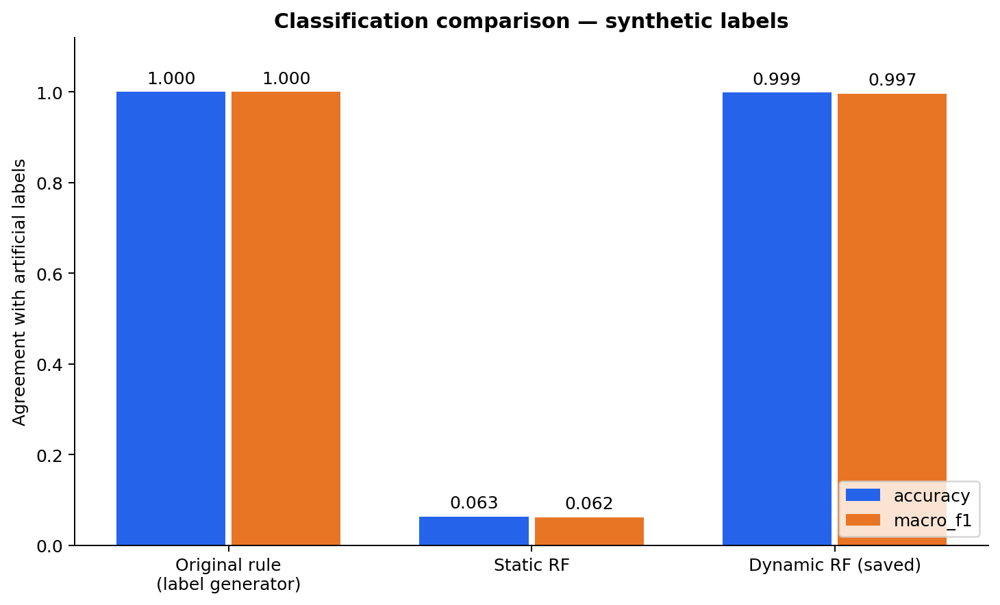
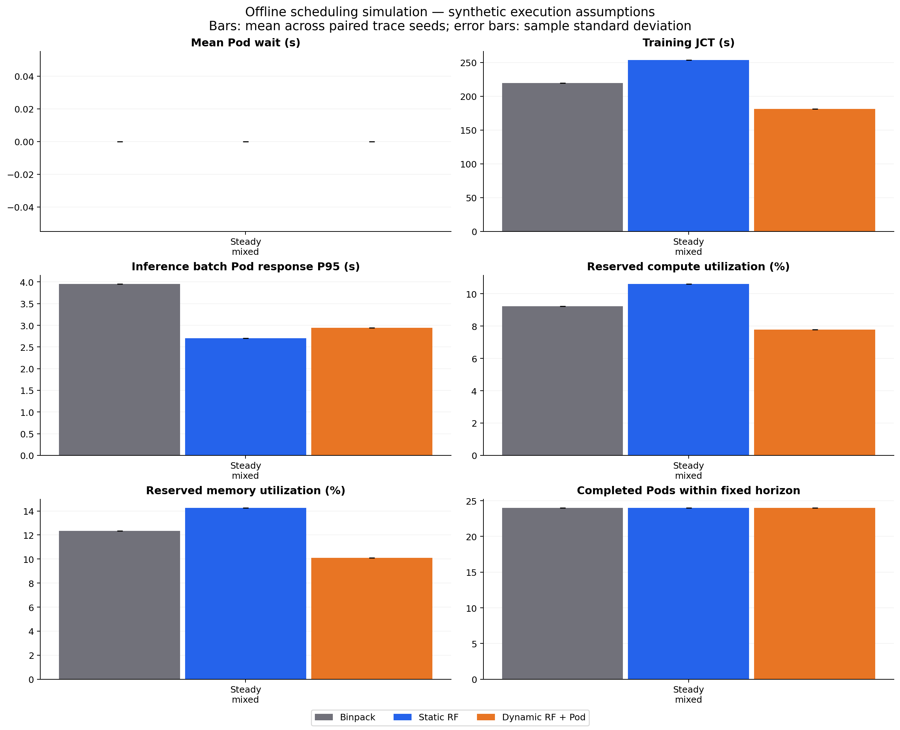

# 第二轮离线实验报告

全部为合成资源状态及合成执行性能，没有真实性能标签，没有连接或修改实际 Kubernetes/Volcano。

## 标签审查

详见 [标签逐项审查](label-audit.md)。训练优先/推理优先是固定参考合同的可行性组合，不是硬件固有能力，也不是厂商的产品定位。第一轮文件与划分保持不变，SHA256 清单见 first-round-preserved-sha256.json。

## 分类对照：对人工参考标签的一致性

| 划分 | 方法 | Accuracy | Macro-F1 | 错分/样本 |
|---|---|---:|---:|---:|
| train | manual_rule | 1.000000 | 1.000000 | 0/5399 |
| train | static_rf | 0.067235 | 0.065478 | 5036/5399 |
| train | dynamic_rf | 1.000000 | 1.000000 | 0/5399 |
| validation | manual_rule | 1.000000 | 1.000000 | 0/1799 |
| validation | static_rf | 0.060033 | 0.060379 | 1691/1799 |
| validation | dynamic_rf | 0.998332 | 0.994604 | 3/1799 |
| test | manual_rule | 1.000000 | 1.000000 | 0/1925 |
| test | static_rf | 0.063377 | 0.062181 | 1803/1925 |
| test | dynamic_rf | 0.998961 | 0.996510 | 2/1925 |

人工规则为标签生成器，因此其 100% 是定义上的一致，不是独立性能验证。静态 RF 使用相同训练集、超参数，仅保留五个硬件特征；动态 RF 直接复用第一轮已保存模型。验证/测试数据不参与本轮拟合。

测试误分类明细为 test-errors-*.csv，四类支持数、Precision/Recall/F1 和混淆矩阵见 classification-comparison.json。

## Pod 评分与准入

所有策略首先执行同一个显存/算力/实例数硬约束。四分类只作软提示，unavailable 仍可能接纳更小 Pod。

动态评分 = 0.30 × RF 对当前任务类型的参考可行概率 + 0.45 × 申请配额下的硬件/共享代理值 + 0.15 × 装箱紧凑度 + 0.10 × 剩余资源平衡度。

RF 是学习部分；其余为显式启发式，并非训练出的真实性能预测器。评分输入包含原始硬件、动态状态、已有类型和当前 Pod 申请；调度器看不到执行 work、隐藏压力或执行 oracle。详见 scoring-policy.json、pod-scoring-demo.json。

Binpack 按分配后归一化剩余显存/算力/实例数排序；静态 RF 按类型概率排序并以 binpack 破同分；动态策略按上述 Pod 评分排序。三者使用相同 FCFS 可行回填、固定申请、不抢占、不自动扩缩配额。

## 独立执行时间模型及公平性

11 卡离线布局为 4090×4、5090×4、L40×3。每个 Pod 本轮申请一个 vGPU、落在一张物理 GPU；不模拟跨卡或多节点训练通信。

执行模型是硬件加权调和速度 × Amdahl 配额缩放 ÷ 同卡共享干扰 × 可复现扰动；与参考标签的 roofline/SLO 公式不同，不读取 RF 类别、概率或评分。参数为独立冻结的合成假设，不是实测标定。模块隔离可以排除直接循环取值，但不能消除同一组人工性能假设带来的偏好。

每次分配和释放重新计算同卡所有任务的进度速率，已运行任务会受后来任务干扰；不是启动时一次算定 duration。扰动由执行种子、Pod ID、GPU 型号的 SHA256 决定，不随策略的事件调用次数变化。

主实验：1 种负载 × 1 个种子 × 3 策略；每条轨迹 24 个 Pod；共同观察窗 600s。
同一配对实验的 trace SHA256、种子、执行配置、干扰倍率、观察窗和硬约束相同。没有策略按未来到达或隐藏工作量选卡。

## 仿真结果

以下为配对种子的算术均值；原始每次运行见 simulation-metrics.csv，均值/样本标准差见 simulation-summary.csv，配对差值见 paired-comparisons.csv。

| 场景 | 策略 | 平均等待 s | 训练 JCT s | 推理批次 Pod 响应 P95 s | 算力预留率 | 显存预留率 | 窗内完成 Pod |
|---|---|---:|---:|---:|---:|---:|---:|
| steady_mixed | binpack | 0.000 | 219.624 | 3.953 | 9.22% | 12.35% | 24.00 |
| steady_mixed | dynamic_rf | 0.000 | 181.312 | 2.942 | 7.79% | 10.10% | 24.00 |
| steady_mixed | static_rf | 0.000 | 253.362 | 2.705 | 10.61% | 14.26% | 24.00 |

## 结果解释与限制

- steady_mixed：动态策略相对 Binpack，训练 JCT 变化 -17.44%，推理批次 Pod 响应 P95 变化 -25.57%。正数表示更慢；不隐藏失败场景。

可能影响结果的机制：静态类别无法反映剩余配额；参考合同不等于当前 Pod；硬件/共享代理值偏好快卡或分散放置，装箱可能更紧凑；大显存 Pod 只能使用部分卡，存在容量碎片和队列阻塞。当前为贪心排序，没有完整的未来需求规划。

这些机制是根据策略实现提出的解释，不是通过本轮数据证明的因果关系；分类和调度收益必须分别评估。当前不能把混合评分的全部收益归因于 RF。

指标口径：等待=Pod start-arrival；训练 JCT=finish-arrival；runtime=finish-start。所有可行任务最终排空，均值含观察窗后完成的任务，避免只统计快任务；另报共同窗内完成数量、窗末未完成数量。

资源利用率为观察窗内预留算力/显存的积分除以总容量和时间，不是 nvidia-smi 或 CUDA 实测利用率。预留率更高也不必然代表效率更好。

推理 Pod 表示有限串行请求批次：P95 是批次 Pod 从到达到完成的响应时间；平均每请求服务时间为累计批次运行时间/请求数；吞吐为共同窗内已完成整批的请求数/时间；SLO 为合成批次响应预算。没有逐 token 延迟、在线服务排队模型或真实请求级 P95。

误差棒为配对种子的样本标准差，不是置信区间或显著性检验。零/双倍干扰敏感性见单独图表；不保证任何策略在其他执行假设下获胜。

## 图表与运行

SVG 可直接导出论文。执行命令：`python -m gpu_lab.round2 --output results/offline-v2`；测试：`python -m pytest -q`。
