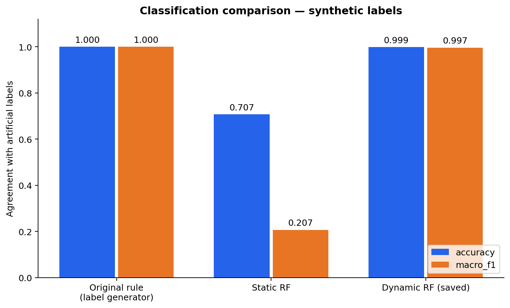
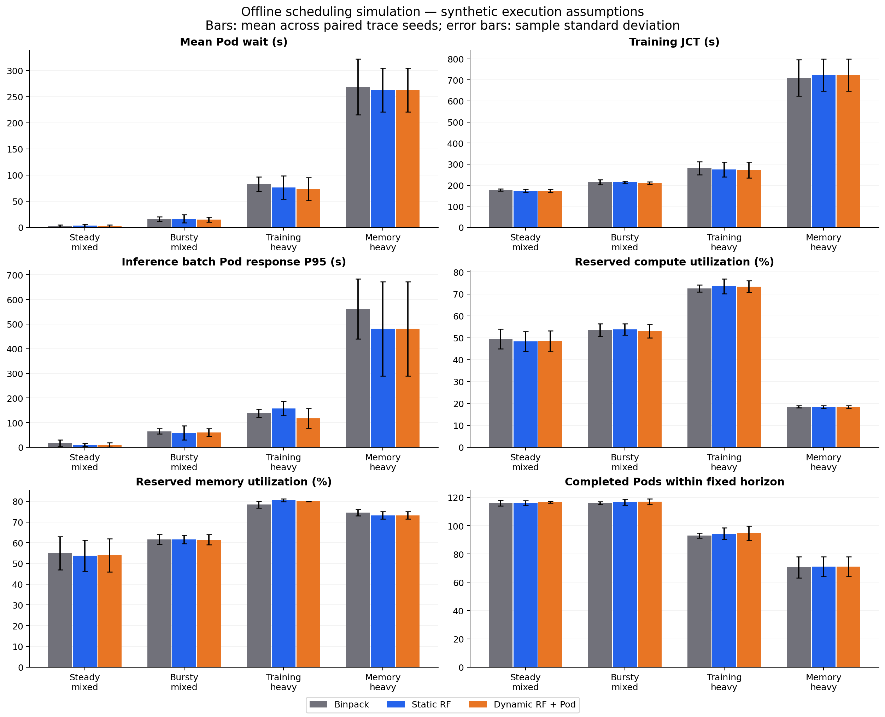

# 第二轮离线实验报告

全部为合成资源状态及合成执行性能，没有真实性能标签，没有连接或修改实际 Kubernetes/Volcano。

## 标签审查

详见 [标签逐项审查](label-audit.md)。训练优先/推理优先是固定参考合同的可行性组合，不是硬件固有能力，也不是厂商的产品定位。第一轮文件与划分保持不变，SHA256 清单见 first-round-preserved-sha256.json。

## 分类对照：对人工参考标签的一致性

| 划分 | 方法 | Accuracy | Macro-F1 | 错分/样本 |
|---|---|---:|---:|---:|
| train | manual_rule | 1.000000 | 1.000000 | 0/5399 |
| train | static_rf | 0.675495 | 0.201581 | 1752/5399 |
| train | dynamic_rf | 1.000000 | 1.000000 | 0/5399 |
| validation | manual_rule | 1.000000 | 1.000000 | 0/1799 |
| validation | static_rf | 0.683713 | 0.203037 | 569/1799 |
| validation | dynamic_rf | 0.998332 | 0.994604 | 3/1799 |
| test | manual_rule | 1.000000 | 1.000000 | 0/1925 |
| test | static_rf | 0.707013 | 0.207091 | 564/1925 |
| test | dynamic_rf | 0.998961 | 0.996510 | 2/1925 |

人工规则为标签生成器，因此其 100% 是定义上的一致，不是独立性能验证。静态 RF 使用相同训练集和树参数，仅保留五个硬件特征；在原验证集上比较 None / balanced_subsample 两种类别权重，按 Macro-F1 选择。候选指标见 classification-comparison.json。直接沿用平衡权重的弱基线已在 smoke 结果保留，不作为最终主基线。动态 RF 直接复用第一轮已保存模型。验证/测试数据不参与拟合；只验证集参与上述基线选择。

测试误分类明细为 test-errors-*.csv，四类支持数、Precision/Recall/F1 和混淆矩阵见 classification-comparison.json。最终静态 RF 在测试集都预测 balanced；相同硬件对应许多不同动态标签，单靠静态输入不能识别这些状态。其连续概率仍可随卡型变化。

## Pod 评分与准入

所有策略首先执行同一个显存/算力/实例数硬约束。四分类只作软提示，unavailable 仍可能接纳更小 Pod。

动态评分 = 0.30 × RF 对当前任务类型的参考可行概率 + 0.45 × 申请配额下的硬件/共享代理值 + 0.15 × 装箱紧凑度 + 0.10 × 剩余资源平衡度。

RF 是学习部分；其余为显式启发式，并非训练出的真实性能预测器。评分输入包含原始硬件、动态状态、已有类型和当前 Pod 申请；调度器看不到执行 work、隐藏压力或执行 oracle。详见 scoring-policy.json、pod-scoring-demo.json。

Binpack 按分配后归一化剩余显存/算力/实例数排序；静态 RF 按类型概率排序并以 binpack 破同分；动态策略按上述 Pod 评分排序。三者使用相同 FCFS 可行回填、固定申请、不抢占、不自动扩缩配额。

## 独立执行时间模型及公平性

11 卡离线布局为 4090×4、5090×4、L40×3。每个 Pod 本轮申请一个 vGPU、落在一张物理 GPU；不模拟跨卡或多节点训练通信。

执行模型是硬件加权调和速度 × Amdahl 配额缩放 ÷ 同卡共享干扰 × 可复现扰动；与参考标签的 roofline/SLO 公式不同，不读取 RF 类别、概率或评分。参数为独立冻结的合成假设，不是实测标定。模块隔离可以排除直接循环取值，但不能消除同一组人工性能假设带来的偏好。

每次分配和释放重新计算同卡所有任务的进度速率，已运行任务会受后来任务干扰；不是启动时一次算定 duration。扰动由执行种子、Pod ID、GPU 型号的 SHA256 决定，不随策略的事件调用次数变化。

主实验：4 种负载 × 3 个种子 × 3 策略；每条轨迹 120 个 Pod；共同观察窗 600s。
同一配对实验的 trace SHA256、种子、执行配置、干扰倍率、观察窗和硬约束相同。没有策略按未来到达或隐藏工作量选卡。

## 仿真结果

以下为配对种子的算术均值；原始每次运行见 simulation-metrics.csv，均值/样本标准差见 simulation-summary.csv，配对差值见 paired-comparisons.csv。

| 场景 | 策略 | 平均等待 s | 训练 JCT s | 推理批次 Pod 响应 P95 s | 算力预留率 | 显存预留率 | 窗内完成 Pod |
|---|---|---:|---:|---:|---:|---:|---:|
| bursty_mixed | binpack | 15.884 | 214.881 | 64.928 | 53.48% | 61.51% | 116.00 |
| bursty_mixed | dynamic_rf | 14.906 | 210.272 | 60.036 | 53.02% | 61.48% | 117.00 |
| bursty_mixed | static_rf | 16.394 | 213.919 | 58.889 | 53.83% | 61.56% | 116.67 |
| memory_heavy | binpack | 268.408 | 709.483 | 561.215 | 18.51% | 74.49% | 70.67 |
| memory_heavy | dynamic_rf | 262.609 | 722.705 | 481.043 | 18.37% | 73.22% | 71.00 |
| memory_heavy | static_rf | 262.614 | 722.722 | 481.043 | 18.37% | 73.22% | 71.00 |
| steady_mixed | binpack | 2.510 | 177.356 | 16.438 | 49.38% | 54.99% | 116.00 |
| steady_mixed | dynamic_rf | 2.528 | 173.293 | 9.947 | 48.46% | 53.89% | 116.67 |
| steady_mixed | static_rf | 3.078 | 173.204 | 10.232 | 48.30% | 53.75% | 116.00 |
| training_heavy | binpack | 82.811 | 281.103 | 138.698 | 72.51% | 78.35% | 93.00 |
| training_heavy | dynamic_rf | 73.212 | 272.766 | 117.407 | 73.37% | 79.90% | 94.67 |
| training_heavy | static_rf | 76.106 | 275.067 | 157.753 | 73.42% | 80.49% | 94.33 |

## 结果解释与限制

- steady_mixed：动态策略相对 Binpack，训练 JCT 变化 -2.29%，推理批次 Pod 响应 P95 变化 -39.49%。正数表示更慢；不隐藏失败场景。
- bursty_mixed：动态策略相对 Binpack，训练 JCT 变化 -2.15%，推理批次 Pod 响应 P95 变化 -7.53%。正数表示更慢；不隐藏失败场景。
- training_heavy：动态策略相对 Binpack，训练 JCT 变化 -2.97%，推理批次 Pod 响应 P95 变化 -15.35%。正数表示更慢；不隐藏失败场景。
- memory_heavy：动态策略相对 Binpack，训练 JCT 变化 +1.86%，推理批次 Pod 响应 P95 变化 -14.29%。正数表示更慢；不隐藏失败场景。

## 算法改进尝试与独立验证

在调度验证种子 [20261017, 20261018] 上比较原评分、两个装箱邻域约束版本及仅对显存受限训练任务启用约束的版本。正式实验种子与验证种子不重叠。验证目标在 policy-validation-selection.json 中固定记录；本轮选择 `original_v1`。

| 验证候选 | 归一化综合成本（低好） |
|---|---:|
| original_v1 | 0.979503 |
| compact_002 | 1.030367 |
| compact_006 | 1.022303 |
| memory_guard | 0.995441 |

部分装箱约束版本在大显存场景改善，却在其他场景损失，故未强行作为最终版本。原评分及改进候选都保留；这不是调参到动态算法必胜。验证指标与原始记录见 policy-validation-*.csv。

## RF 排序贡献消融

使用相同评分结构、装箱约束、硬件/共享启发式；只把 RF 概率权重置零并同比例归一化其他权重。只在主干扰倍率 1 下运行，使用相同正式轨迹。

| 场景 | 含 RF 训练 JCT | 无 RF 训练 JCT | 含 RF 推理批次 P95 | 无 RF 推理批次 P95 |
|---|---:|---:|---:|---:|
| steady_mixed | 173.293 | 173.246 | 9.947 | 10.041 |
| bursty_mixed | 210.272 | 212.708 | 60.036 | 66.665 |
| training_heavy | 272.766 | 272.067 | 117.407 | 178.872 |
| memory_heavy | 722.705 | 722.705 | 481.043 | 481.043 |

RF 增量要看这张表，不能把混合评分相对 Binpack 的全部变化归因于机器学习。RF 分类准确率高，不保证这一人工参考分类信号能改善任意 Pod 的调度。原始配对值见 rf-ablation.csv。

可能影响结果的机制：静态类别无法反映剩余配额；参考合同不等于当前 Pod；硬件/共享代理值偏好快卡或分散放置，装箱可能更紧凑；大显存 Pod 只能使用部分卡，存在容量碎片和队列阻塞。当前为贪心排序，没有完整的未来需求规划。

这些机制是根据策略实现提出的解释，不是通过本轮数据证明的因果关系；分类和调度收益必须分别评估。当前不能把混合评分的全部收益归因于 RF。

指标口径：等待=Pod start-arrival；训练 JCT=finish-arrival；runtime=finish-start。所有可行任务最终排空，均值含观察窗后完成的任务，避免只统计快任务；另报共同窗内完成数量、窗末未完成数量。

资源利用率为观察窗内预留算力/显存的积分除以总容量和时间，不是 nvidia-smi 或 CUDA 实测利用率。预留率更高也不必然代表效率更好。

推理 Pod 表示有限串行请求批次：P95 是批次 Pod 从到达到完成的响应时间；平均每请求服务时间为累计批次运行时间/请求数；吞吐为共同窗内已完成整批的请求数/时间；SLO 为合成批次响应预算。没有逐 token 延迟、在线服务排队模型或真实请求级 P95。

误差棒为配对种子的样本标准差，不是置信区间或显著性检验。零/双倍干扰敏感性见 figures/interference-sensitivity.png；不保证任何策略在其他执行假设下获胜。未模拟控制平面、容器启动、网络或调度模型的实际推理耗时。

## 图表与运行

SVG 可直接导出论文。完整命令与选择过程见项目 README 和 run-config.json；测试：`python -m pytest -q`。

<!-- offline-verification -->
## 自动核验

pytest：65 项，失败/错误均为 0。已核验 54 条完整仿真事件流、19,440 个事件、12,960 次资源账本变更；未发现超分或负等待，全部可行任务排空且资源释放。第一轮 17 个文件 SHA256 未变。相同种子完整复跑后 5 个核心指标文件逐字节一致。详情见 verification.json、reproducibility-check.json、pytest-results.xml。
